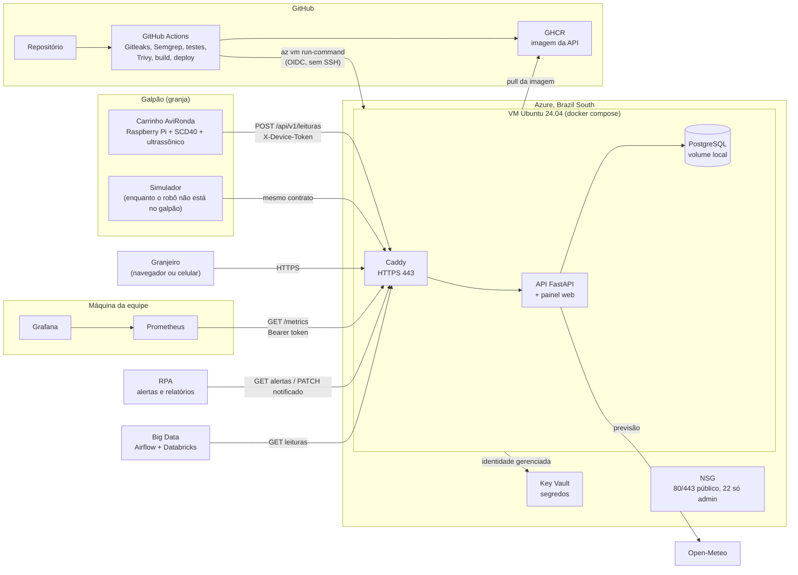

# Arquitetura

## Visão geral

## Componentes deste repositório

| Componente | Tecnologia | Papel |
|---|---|---|
| Proxy | Caddy 2 | Única porta exposta. Termina o HTTPS com certificado automático (Let's Encrypt) para o nome DNS da VM e encaminha para a API. |
| API e painel | Python 3.12, FastAPI, SQLAlchemy | Recebe leituras, valida, classifica, gera alertas, serve o painel e expõe métricas. |
| Banco | PostgreSQL 17 | Leituras, alertas, lotes, zonas e o cadastro do produtor. Sem porta publicada. |
| Simulador | Python | Mesmo contrato do robô. Liga com o perfil `demo` do compose. |
| Infraestrutura | Terraform (azurerm) | Resource group, VNet, NSG, IP público com DNS, Key Vault, VM com identidade gerenciada. |
| Pipeline | GitHub Actions | Barreiras de segurança, testes, build, publicação da imagem e deploy. |
| Observabilidade | Prometheus + Grafana | 4 métricas de ouro, sinais do negócio e alertas. Roda na máquina da equipe, apontando para a URL pública. |

## Fluxo de uma leitura

1. O carrinho para numa zona, espera o sensor estabilizar e envia a leitura com `dispositivo_id`, `lote_codigo`, `zona_codigo` e `medido_em`.
2. A API confere o token do dispositivo, valida a faixa física (leitura absurda vira alerta de falha de sensor, sem alarme de calor) e calcula o ITU.
3. A classificação usa a faixa de conforto da idade do lote ([REGRAS.md](REGRAS.md)). Vale o pior indicador.
4. Leitura crítica isolada vira alerta em **suspeita**. Se a remedição na mesma zona, em até 15 minutos, continuar crítica, o alerta é **confirmado**. Se voltar ao normal, é **descartado** (falso alarme evitado).
5. O RPA lê os alertas confirmados, avisa o produtor e marca como notificado. Só uma pessoa resolve o alerta.
6. O mesmo `dispositivo_id + zona + medido_em` não entra duas vezes: o Pi pode reenviar o que guardou sem internet sem duplicar dados.

## Decisões

| Decisão | Motivo |
|---|---|
| VM com docker compose, em vez de serviço gerenciado de containers | A mesma stack roda igual na máquina do avaliador e na nuvem. Custo previsível e baixo. |
| Deploy por `az vm run-command` | O GitHub não precisa de SSH: nenhuma porta de administração é aberta para a internet. O comando entra pelo plano de controle do Azure, autenticado por OIDC. |
| Segredos gerados pelo Terraform e guardados no Key Vault | Nenhum segredo no repositório, no pipeline ou na imagem. A VM lê com a identidade gerenciada no momento do deploy. |
| Imagem marcada com o SHA do commit | Cada deploy aponta para uma versão exata, e voltar atrás é implantar o SHA anterior. |
| Brazil South | Dados pessoais do produtor ficam no Brasil. |
| Monitoramento fora da VM | Grafana e Prometheus não precisam de porta aberta na nuvem. Se a VM cair, o monitoramento continua de pé e dispara o alerta. |
| Painel sem framework e sem script inline | Página leve para celular de entrada e rede ruim no campo, e CSP restrita (`script-src 'self'`). |
| Granja em 3D com three.js servido pelo próprio site | A tela inicial (`/`) mostra a propriedade inteira, um marcador por galpão (glifo e palavra, nunca só cor). three.js r147 e as fontes ficam em `app/static/granja/`, conferidos com o pacote oficial, sem CDN, então a CSP continua só `'self'`. Sem WebGL, a mesma tela vira um mapa 2D. O detalhe de um galpão com histórico fica em `/galpao?galpao=G1`. |
| Regras explícitas na API | O granjeiro e o avaliador conseguem ver por que uma zona ficou crítica. As partes de IA (RAG e visão) ficam nos componentes das outras disciplinas. |

## Resiliência

- O painel atualiza a cada 30 segundos e cada bloco falha sozinho: sem previsão do tempo, o resto continua. A tela da granja atualiza a cada 60 segundos e só redesenha quando chega leitura nova.
- O painel mostra há quantos minutos o carrinho não envia leitura, e o alerta `AviRondaCarrinhoSemLeitura` dispara com 10 minutos.
- O simulador (e o robô) guarda as leituras numa fila local quando a API está fora e reenvia depois.
- Containers com `restart: unless-stopped`, health check na API e no banco, e o deploy só termina quando a API responde.
