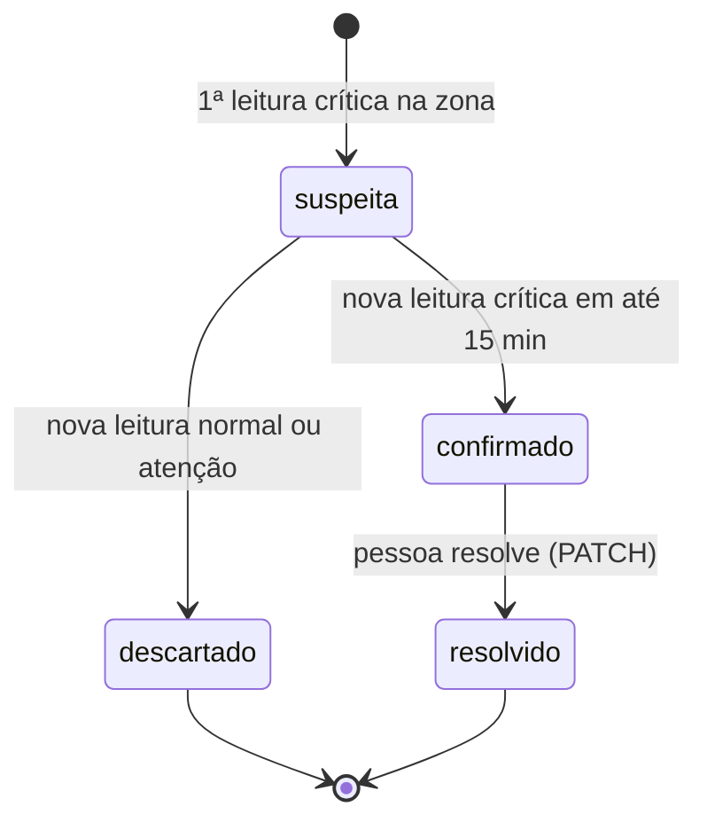

# Regras de classificação

Todas as constantes ficam em [app/regras.py](../app/regras.py) e são cobertas por [tests/test_regras.py](../tests/test_regras.py). São parâmetros iniciais da equipe para o MVP: precisam ser confirmados com o técnico da integradora antes de uso real.

## Nível de cada leitura

A leitura recebe o **pior** nível entre os indicadores abaixo.

| Indicador | Atenção | Crítico | Observação |
|---|---|---|---|
| Temperatura | Fora da faixa de conforto da idade | Mais de 2 °C fora da faixa | Faixa por semana de vida, tabela abaixo |
| ITU | 74 ou mais | 79 ou mais | Só a partir da 3ª semana de vida |
| CO2 | 2.500 ppm ou mais | 3.000 ppm ou mais | |
| Amônia (sensor opcional) | 20 ppm ou mais | 25 ppm ou mais | As fontes divergem entre 20 e 25 ppm |

### Faixa de conforto por semana de vida (frango de corte)

| Semana | Temperatura |
|---|---|
| 1 | 32 a 34 °C |
| 2 | 29 a 31 °C |
| 3 | 26 a 28 °C |
| 4 | 23 a 26 °C |
| 5 em diante | 20 a 23 °C |

### ITU

`ITU = 0,8 × T + (UR / 100) × (T − 14,4) + 46,4` (fórmula de Thom, T em °C e UR em %).

O limite de ITU não vale nas duas primeiras semanas: o pintinho precisa de 32 a 34 °C, e nessa temperatura o ITU fica sempre acima de 79. Nessa fase, quem decide é a faixa de temperatura.

## Fontes

| Número | Fonte |
|---|---|
| Amônia: 20 ppm adotado por exportadores; acima de 60 ppm predispõe a doenças respiratórias | Embrapa |
| Picos de amônia de 29, 78 e 36 ppm contra médias de 4,3, 9,2 e 8 ppm, maiores perto da saída de ar | Embrapa (medição em dark house) |
| Faixa de conforto por semana | Faixa usual dos manuais de manejo de frango de corte. A confirmar com a base do assistente (disciplina Generative AI). |
| Limites de ITU e CO2 | Valores usuais da literatura de ambiência. A confirmar com a base do assistente. |

## Leitura inválida

Fora da faixa física do sensor, a leitura é guardada como inválida, não entra na classificação e abre um alerta `falha_sensor` (sem alarme de calor).

| Grandeza | Faixa aceita |
|---|---|
| Temperatura | −10 a 60 °C |
| Umidade | 0 a 100% |
| CO2 | 300 a 10.000 ppm |
| Amônia | 0 a 200 ppm |

## Ciclo do alerta

O sistema nunca aciona equipamento sozinho. Ele recomenda a ação e a pessoa decide.
